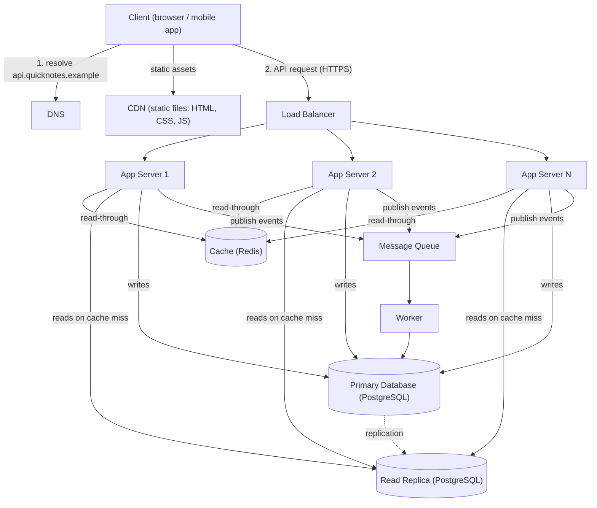

# QuickNotes Architecture (target: 1 million users)

## 1. Requirements

### Functional

- Users can register, log in and log out.
- Users can create, read, update and delete their own notes (title up to 100 characters, optional body).
- Users can tag notes and filter their notes by tag.
- Users can list their notes, newest first, with pagination.
- Notes are private: a user can never read or change another user's notes.
- Background work: send a welcome email and update search/analytics data after a note is created.

### Non-functional

- **Availability:** 99.9% uptime (about 8.8 hours of downtime per year at most); no single point of failure.
- **Latency:** p95 under 300 ms for `GET /notes` and `POST /notes`.
- **Scalability:** serve 1 million users now and scale horizontally for growth.
- **Durability:** a saved note must never be lost (replication and daily backups).
- **Consistency:** a user must see their own note immediately after creating it (read-your-writes); other replicas may lag by a second or two.
- **Security:** HTTPS everywhere, hashed passwords, token authentication, rate limiting.

## 2. Load estimate (1 million users)

Assumptions: 1,000,000 registered users; 30% active per day = **300,000 daily active users (DAU)**; each active user loads their notes 10 times a day and creates 2 notes a day; peak traffic is 3 times the average; an average note row (title, body, ids, timestamps, tags) is about 1 KB, and indexes add about 50%.

| Metric | Calculation | Result |
|--------|-------------|--------|
| Reads per day | 300,000 x 10 | 3,000,000 |
| **Reads per second (average)** | 3,000,000 / 86,400 | **about 35 reads/s** |
| Reads per second (peak, x3) | 35 x 3 | about 105 reads/s |
| Writes per day | 300,000 x 2 | 600,000 |
| **Writes per second (average)** | 600,000 / 86,400 | **about 7 writes/s** |
| Writes per second (peak, x3) | 7 x 3 | about 21 writes/s |
| Read : write ratio | 35 / 7 | about 5 : 1 (read-heavy) |
| New notes per year | 600,000 x 365 | about 219 million |
| **Storage per year** | 219 million x 1 KB | **about 219 GB** (about 330 GB with indexes) |

Conclusion: the load is modest for one well-tuned database, so the design focuses on **availability and low latency** more than raw throughput. Reads dominate, which is why we add a cache and a read replica.

## 3. Architecture diagram

## 4. Components and the problem each solves

- **Client:** the browser or mobile app gives users an interface and calls the REST API described in `api-design.md`.
- **DNS:** translates the friendly name `api.quicknotes.example` into the load balancer's address, and can route users to a healthy region if one fails.
- **CDN:** serves static files (HTML, CSS, JavaScript, images) from servers close to the user, so pages load faster and our app servers are not wasted on static content.
- **Load balancer:** spreads requests across app servers and removes unhealthy ones, so no single server is overloaded and one failure does not take the service down.
- **App servers (two or more):** run the stateless API logic (auth, validation, business rules); because they hold no session state, we can add or remove servers freely to scale.
- **Cache (Redis):** keeps hot results (such as a user's recent notes) in memory, so repeated reads are answered in about a millisecond and the database is protected from the read-heavy load.
- **Primary database (PostgreSQL):** the single source of truth; it accepts all writes and guarantees durable, consistent storage with transactions.
- **Read replica:** a live copy of the primary that serves read queries, which spreads the read load and also acts as a standby to promote if the primary fails.
- **Message queue:** accepts background jobs instantly so the API can respond without waiting for slow work, and holds jobs safely if workers are busy or down.
- **Worker:** consumes jobs from the queue (welcome emails, search indexing, analytics) so slow tasks never delay the user's request.

## 5. Request flows

### GET /notes (read path)

1. The client resolves `api.quicknotes.example` through **DNS** and sends an HTTPS request with its token.
2. The **load balancer** picks a healthy app server.
3. The **app server** validates the token and works out the user id.
4. It looks up the key `notes:user:42:page1` in the **cache**.
5. **Cache hit:** it returns the cached JSON immediately (step 8).
6. **Cache miss:** it runs the "newest notes for user" query on the **read replica**, using the `(user_id, created_at)` index.
7. It stores the result in the cache with a short TTL (for example 60 seconds).
8. The app server returns `200 OK` with the notes JSON through the load balancer to the client.

### POST /notes (write path)

1. The client sends `POST /notes` with its token and the JSON body (title, optional body, tags).
2. The **load balancer** forwards it to a healthy **app server**.
3. The app server authenticates the user and **validates** the input (title required, at most 100 characters); invalid input returns `400`.
4. It inserts the note (and its tag links) into the **primary database** in one transaction.
5. It **invalidates** the user's cached notes list (deletes `notes:user:42:*`) so the next read is fresh and the user sees their new note.
6. It **publishes** a "note.created" event to the **queue** (welcome email, search indexing, analytics).
7. It returns `201 Created` with the new note and a `Location` header. The user is not kept waiting for background work.
8. Later, a **worker** takes the event from the queue and does the slow work; failed jobs are retried and eventually moved to a dead-letter queue.

## 6. Trade-offs

1. **Cache speed vs freshness.** Caching makes reads fast but cached data can be stale. We accept a short TTL (60 s) and also invalidate the user's cache on every write, so users always see their own changes, trading a little extra write work for correctness.
2. **Replica lag (eventual consistency) vs read scalability.** The read replica spreads load, but it can be a second or two behind the primary. We accept that for lists, and for the "read-your-writes" case the app serves a user's own just-written data from the primary or relies on cache invalidation. Strong consistency everywhere would give up scalability.
3. **Queue (asynchronous) vs simplicity.** The queue keeps the API fast and resilient, but adds a component to run and means background results (emails, search updates) arrive slightly later. Workers must be idempotent because a job can be delivered more than once.
4. **SQL vs NoSQL.** We chose PostgreSQL for relations and transactions (see `data-model.md`), trading some horizontal write scalability that we do not need yet.

## 7. Avoiding single points of failure

| Component | How a single point of failure is avoided |
|-----------|------------------------------------------|
| DNS | Use a managed DNS provider with several name servers worldwide. |
| CDN | CDNs are distributed across many edge locations by design. |
| Load balancer | Run a redundant pair (active/active or active/standby with failover) or use a managed, multi-zone load balancer. |
| App servers | Two or more stateless servers in different availability zones; the load balancer's health checks remove failed ones. |
| Cache | Redis with a replica and automatic failover; if the cache is lost the app still works by reading from the database (slower, not down). |
| Primary database | Streaming replication to the read replica (ideally in another zone) with automatic promotion if the primary fails; point-in-time backups for recovery. |
| Queue | A managed or clustered queue with replicated storage; messages persist until acknowledged. |
| Worker | Several worker instances; if one dies, another picks up the job (jobs are acknowledged only after success). |

Everything runs in at least two availability zones, so the loss of one data centre degrades capacity but does not stop the service.
